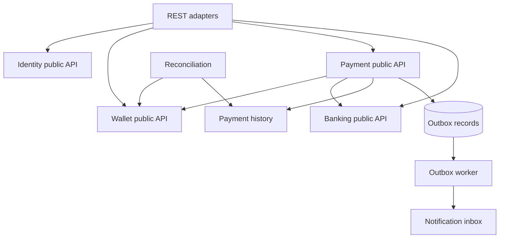

# Phase 2 — Lộ trình cải tiến kiến trúc và thuộc tính chất lượng

> Trạng thái: kế hoạch đề xuất để triển khai, chưa phải kết quả đã nghiệm thu.
> Ngày lập: 17/11/2026. Người thực hiện: A và B (thay bằng tên thành viên khi bắt đầu).
> Cơ sở khảo sát: `phase2_assessment.md`. Tài liệu này chốt lại phạm vi Phase 2 theo thuộc tính chất lượng, thay cho hướng mở rộng multi-wallet ở bản khảo sát ban đầu.

## 1. Mục tiêu, phạm vi và nguyên tắc

**Mục tiêu:** chuyển backend hiện tại thành Modular Monolith có ranh giới được kiểm chứng, một luồng thực thi giao dịch nguyên tử, idempotency bền vững và Transactional Outbox. Chứng minh tác động tới khả năng bảo trì, độ tin cậy, khả năng phục hồi, khả năng quan sát và hiệu năng bằng test và số đo trước–sau.

### 1.1. Trong phạm vi

- Giữ Java 21, Spring Boot, MySQL và API nghiệp vụ Phase 1 làm nền.
- Tổ chức lại module Identity, Wallet, Banking, Payment, Notification; thêm Reconciliation sau khi đường ghi tiền ổn định.
- Idempotency cho topup, withdraw, transfer; tiền, bản ghi giao dịch, kết quả replay và outbox cùng transaction.
- Kiểm soát đồng thời trên DB, rollback, retry hữu hạn và kiểm thử nhiều app instance.
- Notification inbox trong DB làm kênh nghiệm thu chính; worker phục hồi và xử lý chống trùng.
- Migration, CI, phân trang lịch sử, metrics/log, đối soát và benchmark tái lập được.

### 1.2. Ngoài phạm vi

- Multi-wallet, đa tiền tệ, FX, UI mới, ngân hàng thật, email/SMS production, Kubernetes, Kafka và chia microservices.
- Ledger sổ kép đầy đủ, tài khoản kế toán và quy trình quyết toán tiền thật. Bảng giao dịch hiện tại tiếp tục là lịch sử nghiệp vụ; không gọi nó là sổ kép.
- Nạp/rút vẫn là mô phỏng; mọi tài liệu demo phải ghi rõ giới hạn này.

### 1.3. Nguyên tắc bắt buộc

1. Số dư không âm, không mất cập nhật, một yêu cầu idempotent có tối đa một tác động lên tiền.
2. Không cho phép eventual consistency giữa debit, credit và lịch sử của cùng giao dịch nội bộ.
3. Notification và đối soát được phép xử lý sau commit; lỗi worker không làm mất giao dịch tiền đã commit.
4. Mỗi thay đổi kiến trúc phải có contract, bằng chứng và cách phục hồi. Đổi package đơn thuần chưa đủ chứng minh chất lượng tăng.
5. Không sửa code ngoài phạm vi ticket để tiện tay refactor. Không đổi kết quả kỳ vọng của test chỉ để vượt gate.

## 2. Kiến trúc đích và quyền sở hữu



### 2.1. Cấu trúc đề xuất

```text
sa.uet.digitalwallet_system
  identity/{api,application,domain,adapter}
  wallet/{api,application,domain,adapter}
  banking/{api,application,domain,adapter}
  payment/{api,application,domain,adapter}
  notification/{api,application,domain,adapter}
  reconciliation/{application,adapter}
  platform/{config,security,observability,outbox}
```

`api` ở đây là Java API nội bộ của module, không đồng nghĩa REST controller. DTO công khai không chứa JPA entity. `platform` chỉ chứa hạ tầng dùng chung; không trở thành nơi gom quy tắc nghiệp vụ.

| Module | Sở hữu dữ liệu | Public API dự kiến | Được phụ thuộc |
|---|---|---|---|
| Identity | users | đăng ký, đăng nhập, truy vấn định danh tối thiểu | platform |
| Wallet | wallets | tạo ví, truy vấn có quyền, debit/credit trong transaction hiện tại | platform |
| Banking | linked_bank_accounts | link/unlink, xác nhận liên kết ACTIVE thuộc ví | Wallet API, platform |
| Payment | transactions, idempotency_requests | topup/withdraw/transfer, tra cứu/lịch sử | Wallet API, Banking API, outbox port |
| Notification | notifications | ghi inbox idempotent, đọc inbox của caller | event contract, platform |
| Reconciliation | reconciliation_runs/findings | chạy đối soát và đọc báo cáo | API đọc Wallet/Payment |

Identity đăng ký và tạo ví qua orchestration ở composition layer hoặc một use case phụ thuộc Wallet API; chốt một chiều bằng ADR để tránh vòng phụ thuộc Identity↔Wallet. Wallet không import Identity internals.

### 2.2. Transaction boundary

- Payment execution service là chủ transaction của thao tác ghi tiền.
- Wallet/Banking tham gia cùng transaction manager và datasource; không dùng `REQUIRES_NEW` cho debit/credit, lịch sử hoặc outbox.
- Debit/credit chỉ cho gọi trong transaction hợp lệ; quy tắc này được kiểm tra bằng integration test và cấu hình transaction phù hợp.
- Retry facade nằm ngoài execution service; mỗi attempt tạo transaction mới và đọc lại dữ liệu. Không gọi method qua `this` rồi kỳ vọng Spring proxy áp dụng transaction/retry.
- Worker transaction độc lập với transaction Payment. Không gửi email, HTTP hoặc chờ dịch vụ ngoài khi giữ khóa ví.
- Kiểm tra kiến trúc bằng ArchUnit hoặc công cụ tương đương: cấm vòng phụ thuộc, import repository/entity ngoài module, domain import Spring/JPA; application được phép dùng Spring theo ADR đã chốt.

## 3. Thuộc tính chất lượng và tiêu chí đánh giá

Các mốc thời gian dưới đây là mục tiêu ban đầu cho môi trường nghiệm thu, không phải số đo đã đạt. Khóa cấu hình máy và workload tại C00; chỉ điều chỉnh mục tiêu qua ADR kèm lý do trước khi đo kết quả cuối.

| ID | Kịch bản | Phản ứng mong đợi | Ngưỡng/gate |
|---|---|---|---|
| QA01 | 100 request đồng thời, cùng actor/operation/key/payload | Một giao dịch, các response thành công tham chiếu cùng mã | 0 ghi tiền trùng; request đang chạy có thể nhận lỗi retryable được đặc tả |
| QA02 | Ví 100, chi đồng thời 80 và 70 | Một thành công, một thiếu tiền sau khi xử lý conflict | Số dư cuối 20 hoặc 30; đúng một lịch sử thành công |
| QA03 | Chèn lỗi sau debit, trước credit hoặc trước commit | Rollback toàn bộ | 0 thay đổi tiền/lịch sử/outbox/idempotency hoàn tất |
| QA04 | Commit xong, mất response, restart app rồi retry | Replay kết quả cũ | 0 giao dịch mới và 0 outbox mới |
| QA05 | Dừng worker 5 phút, Payment tiếp tục chạy | Sự kiện tồn được xử lý khi worker trở lại | Không mất event; inbox không trùng; mục tiêu xử lý hết backlog thử nghiệm trong 2 phút |
| QA06 | Hai worker claim cùng backlog; một worker crash | Lease hết hạn được thu hồi, xử lý tiếp | 0 notification logic trùng; không có event bị kẹt vô hạn |
| QA07 | Một module import repository module khác | Build từ chối | Architecture test thất bại đúng lỗi |
| QA08 | Chạy tải chuẩn trước/sau | Đo khả năng đáp ứng và regression | 0 invariant violation; p95 không tăng quá 10% và throughput không giảm quá 10% ở tải chuẩn đã khóa |
| QA09 | Gây sai lệch số dư trong DB test | Đối soát phát hiện đúng ví và chênh lệch | Phát hiện toàn bộ ca gieo lỗi; không báo sai ca đúng |
| QA10 | Request của user A tra cứu dữ liệu B | Bị từ chối theo contract | Không lộ số dư, giao dịch, inbox hoặc liên kết ngân hàng |

QA08 là gate regression ban đầu, không phải tuyên bố hệ thống nhanh hơn. Báo cáo riêng cả chi phí độ trễ của idempotency/outbox. QA05 phải ghi số event, cấu hình worker và tốc độ sự kiện mới; không dùng ngưỡng 2 phút cho backlog không giới hạn.

## 4. Phân công hai người

| Người | Trách nhiệm chính | Trách nhiệm review |
|---|---|---|
| **A — Bạn: Technical Lead & Transaction/Domain** | Thiết kế kiến trúc; Wallet/Banking/Payment, money rules, idempotency, concurrency, transaction contracts; nghiệm thu và quyết định release | Review PR của B; tự kiểm tra PR của A; duy nhất A quyết định và thực hiện merge |
| **B — Platform & Verification** | Baseline, CI/MySQL tests, migration framework, Identity/platform, outbox worker, inbox, metrics, benchmark, reconciliation; tự kiểm tra phần mình và bàn giao bằng chứng | Không cần review, approve hoặc ký nghiệm thu PR của A; chỉ sửa PR của B theo yêu cầu A |

Quy tắc: A vừa code vừa là người nghiệm thu cuối cùng và duy nhất có quyền merge. Với PR do A viết, A tự kiểm tra contract và kết quả CI; không cần B review/approve. Với PR do B viết, A review và yêu cầu sửa khi cần. B không có quyền merge. Cùng sửa một file phải bàn giao rõ; mọi thay đổi contract công khai do A chốt trước khi triển khai.

### 4.1. File và tài nguyên có chủ sở hữu tích hợp

- A điều phối thay đổi `payment`, `wallet`, `banking`, API ghi tiền và các migration nghiệp vụ sau khi B mở nền migration.
- B điều phối `build.gradle`, cấu hình chung, Docker/test infrastructure, `platform`, `notification`, `reconciliation` và CI.
- Mã version migration đặt trước trong ticket; không đổi số migration đã merge. Người tạo migration chịu trách nhiệm nội dung; A chốt thứ tự; B triển khai kiểm tra migration trong CI, không cần review PR của A.
- A sở hữu event payload nghiệp vụ; B sở hữu outbox delivery envelope. B đề xuất envelope; A phê duyệt contract event trước khi code publisher/consumer.
- Mỗi người có branch riêng theo ticket, ví dụ `codex/p2-c03-idempotency`; tích hợp từng PR nhỏ theo dependency.

## 5. Lộ trình triển khai và dependency

Ước lượng 6 tuần cho hai người làm bán thời gian tương đối đều; điều chỉnh theo thời gian thực tế. Gate quan trọng hơn ngày kết thúc. Không bắt đầu ticket phụ thuộc khi contract đầu vào chưa chốt.

| Tuần | A | B | Gate kết thúc |
|---|---|---|---|
| 1 | C01 thiết kế ranh giới, kiểm kê API | C00 baseline; C02 nền DB/CI sau khi chốt schema policy | Baseline có thể tái lập, ADR và migration nền được ký |
| 2 | C03 modular hóa Wallet/Banking/Payment | C03 Identity/platform; architecture tests và regression | API Phase 1 tương đương; ranh giới module được bảo vệ |
| 3 | C04 idempotency; C05 atomicity/concurrency | Xây test harness DB dùng chung theo contract A chốt; C06 outbox storage; không review PR A | Ghi tiền đúng khi trùng, cạnh tranh và lỗi |
| 4 | C06 ghi outbox nguyên tử, hỗ trợ fault tests | C07 worker/inbox và recovery tests | Worker chết không mất event, không trùng inbox |
| 5 | C08 query/history; C09 security phần ownership | C09 logs/metrics; C10 reconciliation | Có thể truy vết, đối soát và truy vấn có giới hạn |
| 6 | Sửa lỗi phát hiện qua C11; hoàn thiện ADR | C11 benchmark, failure campaign, tổng hợp evidence | C12 nghiệm thu tích hợp và runbook |

Dependency chính: `C00 → C01/C02 → C03 → C04 → C05 → C06 → C07`; C08/C09 chạy sau C03 khi không đụng file chung; C10 sau contract dữ liệu C05; C11 sau C07–C10; C12 sau toàn bộ.

## 6. Contract dùng chung cho mọi lần sửa

### 6.1. Definition of Ready — trước khi code

- [ ] Có ticket ID, owner A/B và người nghiệm thu/merge A; PR của A ghi rõ tự kiểm tra.
- [ ] Ghi vấn đề/kịch bản chất lượng được tác động.
- [ ] Chốt input/output, error codes và tương thích API.
- [ ] Ghi module/file/schema được phép thay đổi.
- [ ] Chốt invariant, transaction boundary và dependency.
- [ ] Có test nghiệm thu với kết quả mong đợi, dữ liệu khởi tạo và cách chạy.
- [ ] Có chiến lược rollback hoặc roll-forward; xác định dữ liệu mới có đọc được bởi bản cũ không.

### 6.2. Definition of Done — trước merge

- [ ] Code đúng scope; public contract và tài liệu khớp implementation.
- [ ] Test liên quan và regression bắt buộc đều pass trên môi trường ghi rõ.
- [ ] Có test thất bại trước bản sửa hoặc bằng chứng tái hiện vấn đề khi phù hợp.
- [ ] Migration thử trên DB mới và DB Phase 1 có dữ liệu nếu schema thay đổi.
- [ ] Không log token/password/secret/số tài khoản đầy đủ; không trả exception nội bộ cho client.
- [ ] Không phá architecture rules; không tăng dependency trái ADR.
- [ ] Evidence ghi commit SHA, command, config, kết quả và hạn chế; không ghi “pass” khi chưa chạy.
- [ ] A ghi PASS/FAIL và lý do; PR của A được A tự kiểm tra, không cần B approve. Thiếu bằng chứng ghi NOT RUN/BLOCKED, chưa merge.
- [ ] GitHub required checks PASS trên commit mới nhất; lưu URL workflow run và head SHA. Không dùng kết quả local thay cho GitHub CI.
- [ ] Không push trực tiếp main, không auto-merge; chỉ A thực hiện merge sau khi thỏa mãn CI và contract.

### 6.3. Template contract cho từng PR hoặc bản sửa tiếp theo

```markdown
# Contract P2-Cxx-rN
Owner: A/B | Người nghiệm thu và merge: A | Base SHA: ... | Candidate SHA: ...
Chế độ review: A tự kiểm tra / A review PR của B
GitHub PR URL: ... | CI run URL: ... | CI head SHA: ... | Required checks: ...
Vấn đề và QA liên quan: ...
Phạm vi thay đổi / phần không thuộc scope: ...
Dependency và contract đầu vào: ...
API/schema/event thay đổi: ...
Invariants và transaction boundary: ...
Given / When / Then cho từng case: ...
Commands, môi trường, seed, concurrency, timeout: ...
Bằng chứng thực tế và đường dẫn artifact: ...
Compatibility và rollback/roll-forward: ...
Kết quả: PASS / FAIL / NOT RUN / BLOCKED
A xác nhận nghiệm thu, ngày, nhận xét: ...
```

Một contract bị FAIL được sửa bằng `r2`, `r3`…; giữ bằng chứng lần trước. Dù sửa nhỏ vẫn ghi contract ngắn: tác động, test liên quan và reviewer; không cần chạy lại toàn bộ benchmark nếu không tác động đường chạy hoặc cấu hình hiệu năng. Nếu thay đổi API/schema/transaction boundary phải cập nhật contract và ADR trước khi merge.

## 7. Checklist và contract theo đợt sửa

### C00 — Baseline có thể tái lập

**Owner B; reviewer A.** Đầu vào: Phase 1 chưa sửa hành vi.

- [ ] Ghi commit gốc, JDK, Gradle, MySQL, CPU/RAM, cấu hình app/DB/load generator.
- [ ] Kiểm kê endpoint, payload, status code và các test hiện có; ghi rõ test mock và DB thật.
- [ ] Chạy test hiện tại; phân loại lỗi môi trường và lỗi code, không âm thầm bỏ test.
- [ ] Tạo seed có thể reset trên DB test riêng; không chạy reset trên dữ liệu người dùng.
- [ ] Tách load generator và SUT, hoặc công bố rõ hạn chế nếu chưa có máy riêng.
- [ ] Lưu baseline workload, latency p50/p95/p99, achieved RPS, lỗi theo nhóm, tài nguyên.

**Contract:** cùng commit/config/seed chạy lại được các bước; số liệu có raw output. Test chưa chạy phải ghi NOT RUN. Gate chưa yêu cầu Phase 1 pass toàn bộ, nhưng mọi failure phải được liệt kê và có ticket xử lý. Rollback: không thay đổi hành vi ứng dụng.

### C01 — ADR và module contracts

**Owner A; A tự kiểm tra và nghiệm thu, không cần B review.**

- [ ] ADR-001: Modular Monolith, dependency graph và mức Spring coupling cho application.
- [ ] ADR-002: transaction owner, retry boundary và chiến lược khóa ban đầu.
- [ ] ADR-003: idempotency lifecycle và compatibility policy.
- [ ] ADR-004: outbox/inbox delivery semantics, lease và event versioning.
- [ ] Chốt Java public interfaces, quyền sở hữu bảng, error code và event schema.

**Contract:** mỗi bảng có một owner; graph không có cycle; mọi thao tác tiền có chủ transaction; không có lời hứa exactly-once gửi ra hệ thống ngoài. Reviewer đối chiếu ít nhất một luồng topup, transfer, unlink và register. Gate này nghiệm thu thiết kế, chưa tuyên bố code thực hiện đúng.

### C02 — Migration và nền kiểm thử DB/CI

**Owner B; reviewer A.**

- [ ] Thêm Flyway hoặc Liquibase, chọn một công cụ.
- [ ] Baseline schema Phase 1 được quản lý rõ; không tự động đánh baseline một DB bất kỳ mà không xác minh schema.
- [ ] Tách config test/dev/production; production dùng validate thay vì update.
- [ ] Testcontainers MySQL hoặc DB test biệt lập tương đương; CI không dùng DB cá nhân.
- [ ] CI chạy build, unit/web, architecture và DB integration tests.
- [ ] Loại bỏ xung đột giữa SQL init của Docker và migration owner; test cả volume mới và DB đã tồn tại.

**Contract:** DB trống khởi tạo được; DB Phase 1 có user/ví/liên kết/giao dịch nâng cấp không mất giá trị; restart không chạy lặp migration. Schema không tương thích phải fail rõ. Rollback ứng dụng chỉ khi schema tương thích; migration đã áp dụng được sửa bằng migration mới, không sửa file cũ.

### C03 — Modular hóa không đổi hành vi

**Owner A cho Wallet/Banking/Payment; B cho Identity/platform và test kiến trúc. A review/nghiệm thu và merge; không cần B review phần A.**

- [ ] Di chuyển từng module, giữ hexagonal bên trong; mỗi lần di chuyển build/test trước khi sang module tiếp.
- [ ] Thay import trực tiếp bằng public module API.
- [ ] Giữ REST path/body/status Phase 1 ở bước này.
- [ ] Domain không import Spring/JPA; không expose JPA entity qua module API.
- [ ] Architecture tests bảo vệ dependency graph, repository ownership và cycle.
- [ ] Cập nhật sơ đồ kiến trúc theo code cuối.

**Contract:** regression API đã chốt C00 pass; chuyển tiền vẫn nguyên tử trên DB; test cố tình import internals phải bị architecture rule phát hiện. Không tạo migration đổi dữ liệu chỉ để đổi package. Rollback: revert refactor commit khi schema chưa đổi.

### C04 — Idempotency bền vững

**Owner A; A tự kiểm tra và nghiệm thu. B cung cấp test harness dùng chung theo contract, không review PR của A.**

- [ ] Bảng unique `(actor_id, operation, idempotency_key)`, request hash, response snapshot cần replay và transaction reference.
- [ ] Header bắt buộc cho API ghi tiền ở release Phase 2; thiếu/không hợp lệ trả 400 với mã lỗi ổn định. Đây là breaking change có chủ đích: cập nhật OpenAPI, client test và k6; nếu cần client cũ phải thiết kế version API riêng trước triển khai.
- [ ] Hash dùng request đã chuẩn hóa, gồm source wallet, target/bank, amount, description theo policy; actor lấy từ authentication.
- [ ] Same key/same payload replay status và business response đã lưu; không yêu cầu trace id/timestamp hạ tầng mới phải giống response cũ.
- [ ] Same key/different payload trả 409 `IDEMPOTENCY_KEY_REUSED`.
- [ ] Request đang chạy chờ có giới hạn hoặc trả 409 `REQUEST_IN_PROGRESS` và hướng dẫn retry cùng key; không chạy giao dịch thứ hai.
- [ ] Đối với transaction đồng bộ: claim key và hoàn tất cùng transaction; rollback không để key thành công giả. Duplicate unique được xử lý sau khi transaction lỗi đã rollback.
- [ ] Chỉ lưu success đã commit trong scope này; business failure không cache. Ghi rõ retry một business failure sau thay đổi trạng thái có thể cho kết quả khác.
- [ ] Giữ key trong toàn bộ thời gian Phase 2, chưa triển khai cleanup; thiết kế retention sau phải xét thời hạn retry và rủi ro tái xử lý.

**Contract:** QA01/QA04 pass trên hai instance cùng DB; khác actor hoặc operation không nhầm replay; hai payload giống nhau với hai key khác nhau là hai yêu cầu. Replay không thêm transaction/outbox. Rollback: dừng traffic ghi trước khi hạ về bản chưa hỗ trợ idempotency; không drop bảng hoặc giả định bản cũ giữ được guarantee này.

### C05 — Money invariants, atomicity và concurrency

**Owner A; A tự kiểm tra và nghiệm thu, không cần B review.**

- [ ] Validation amount tại use case/domain; không chỉ dựa `@Valid` ở controller.
- [ ] Kiểm tra overflow khi credit; quy định giới hạn giao dịch/số dư trong contract cấu hình.
- [ ] Kiểm tra ví ACTIVE, quyền sở hữu và liên kết ngân hàng ACTIVE.
- [ ] Unlink và topup/withdraw có điểm tuần tự hóa rõ: khóa cùng bản ghi bank link trong transaction, hoặc thiết kế tương đương được chứng minh.
- [ ] Retry optimistic conflict/deadlock tối đa 3 attempts tổng cộng; backoff có jitter và giới hạn thời gian; không retry lỗi nghiệp vụ.
- [ ] Mỗi attempt transaction mới; hết retry trả lỗi conflict retryable có machine code riêng; deadlock/lock timeout không bị gộp nhầm thành thiếu tiền.
- [ ] Nếu thử pessimistic locking, lock ví theo id tăng dần rồi kiểm tra balance/status; chỉ thay mặc định sau benchmark so sánh.
- [ ] Fault hook chỉ bật ở test để fail sau debit, sau credit, sau ghi history và trước commit.

**Contract:** QA02/QA03 pass; thêm tổng chi nhỏ hơn balance, A↔B, hot receiver, unlink đồng thời và overflow. Đối soát DB sau mỗi test, không chỉ kiểm tra HTTP. Repeat bộ race ít nhất 100 vòng có timeout, synchronization barrier và ghi seed. Repetition là bổ sung, không thay cho thiết kế lịch chạy có kiểm soát. Khi lỗi, không sửa bằng cách nới invariant.

### C06 — Event contract và ghi outbox nguyên tử

**Owner A cho publisher; B cho storage/claim design; A review/nghiệm thu và merge; không cần B review phần A.**

- [ ] Event `payment.completed.v1`: eventId, transactionId/referenceCode, type, amount, source/target wallet IDs phù hợp, occurredAt, correlationId, schemaVersion; không kèm secret hoặc thông tin tài khoản đầy đủ.
- [ ] Mỗi transaction thành công tạo một event nghiệp vụ; unique theo transaction/event type để bảo vệ phát trùng do bug.
- [ ] Outbox có payload, status, attempts, nextAttemptAt, leaseUntil, claimToken/owner và lastError được giới hạn độ dài.
- [ ] Debit/credit/history/idempotency result/outbox commit cùng nhau.
- [ ] Chốt ordering: chưa bảo đảm thứ tự notification toàn cục; consumer không dựa delivery order để tính số dư.

**Contract:** giao dịch commit có đúng một outbox event; rollback ở mọi fault hook không để event mồ côi. Replay không thêm event. Payload được consumer test đọc đúng theo schema v1. Thay schema sau này phải có version/compatibility tests.

### C07 — Worker, inbox và phục hồi

**Owner B; reviewer A.**

- [ ] Worker claim theo batch trong transaction ngắn, có lease và claim token; không giữ khóa DB khi gọi tác vụ ngoài.
- [ ] Khi hoàn tất chỉ owner có token hiện tại được cập nhật claim; worker cũ không ghi đè lease mới.
- [ ] Lease hết hạn được thu hồi; timeout xử lý và thời hạn lease được cấu hình, có test clock hoặc fault orchestration.
- [ ] Với inbox cùng MySQL: insert inbox và đánh dấu outbox hoàn tất trong cùng transaction xử lý.
- [ ] Unique `(event_id, recipient_id, channel)`; chọn người nhận theo quy tắc từng loại giao dịch.
- [ ] Retry có backoff/jitter, giới hạn attempts, trạng thái DEAD và thao tác replay có audit.
- [ ] Có công tắc tắt worker, không tắt API ghi tiền.
- [ ] API đọc inbox có phân trang và kiểm tra caller; nếu chỉ demo nội bộ, vẫn test ownership tại service.

**Contract:** QA05/QA06 pass; hai worker không tạo inbox trùng; kill sau claim, sau insert và trước mark done đều phục hồi đúng. Poison event vào DEAD không chặn event khác. Replay DEAD không tạo inbox trùng. Kênh email/SMS không thuộc guarantee nghiệm thu.

### C08 — Query lịch sử có giới hạn

**Owner A; A tự kiểm tra và nghiệm thu, không cần B review.**

- [ ] Tách query service khỏi command execution, vẫn cùng DB; chưa xây projection bất đồng bộ.
- [ ] Cursor `(created_at,id)`, page size mặc định 20 và tối đa 100; xác thực cursor và filter.
- [ ] Chọn version API hoặc compatibility adapter vì chuyển List thành page là thay đổi contract.
- [ ] Kiểm tra EXPLAIN trên seed lịch sử lớn trước khi thêm index.
- [ ] Đo riêng truy vấn OR hiện tại với phương án hai nhánh, chọn dựa dữ liệu.

**Contract:** quyền đọc đúng; nhiều transaction cùng timestamp không lặp/mất bản ghi khi duyệt dataset cố định; ghi mới trong lúc phân trang có semantics được mô tả; không tải toàn lịch sử vào memory. Báo số liệu trên seed ít nhất 100.000 giao dịch và ghi phần chi phí index khi ghi tiền.

### C09 — Security và observability

**Owner A cho ownership/money logs; B cho config/metrics; A review/nghiệm thu và merge; không cần B review phần A.**

- [ ] Production thiếu JWT secret thì startup fail; test/dev có secret riêng.
- [ ] Generic 500 không lộ `ex.getMessage()`; log server có trace id và stack trace đã kiểm soát dữ liệu nhạy cảm.
- [ ] Correlation id được tạo/validate ở ingress; log nối được API, retry, transaction và event.
- [ ] Metrics: duration/status theo endpoint, conflict/deadlock/retry, replay, pool DB, outbox pending/oldest age/DEAD, reconciliation findings.
- [ ] Không dùng userId/transactionId/idempotency key làm metrics label gây cardinality lớn.
- [ ] Health/readiness phân biệt app/DB; worker lỗi được cảnh báo riêng, không restart app liên tục chỉ vì có DEAD event.
- [ ] Log và dashboard không public qua cấu hình mặc định.

**Contract:** QA10 pass; tái hiện 500 thấy trace id nhưng không thấy nội bộ ở response; truy được retry và event từ log; secret không có trong artifact. Worker ngừng tạo tín hiệu quan sát rõ và Payment vẫn phục vụ khi DB còn hoạt động.

### C10 — Đối soát độc lập

**Owner B; reviewer A.**

- [ ] Baseline số dư đầu kỳ theo wallet tại cutoff nhất quán trước khi mở traffic Phase 2; không mặc định ví cũ có số dư 0.
- [ ] Expected balance = opening balance + topup + transfer-in − withdraw − transfer-out sau cutoff; chỉ tính giao dịch thành công đã commit.
- [ ] Đọc balance và transactions trong cùng consistent snapshot của MySQL hoặc cơ chế cutoff tương đương; không báo sai do đọc hai thời điểm.
- [ ] Báo runId, cutoff, wallet, expected/actual/delta; ghi kết quả đối soát, không tự động sửa tiền.
- [ ] Có test dữ liệu hợp lệ, sai balance, thiếu history và trường hợp opening balance khác 0.

**Contract:** QA09 pass; chạy trong lúc có giao dịch không báo sai do snapshot lệch. Công bố giới hạn: nếu tiền và history cùng sai theo cách khớp nhau, phép đối soát này có thể không phát hiện; nó không thay thế sổ kép hoặc đối soát ngân hàng độc lập.

### C11 — Benchmark và chiến dịch lỗi

**Owner B; A hỗ trợ phân tích/sửa lỗi; reviewer A.**

- [ ] Giữ workload/config C00; điều chỉnh script chỉ để đáp ứng contract mới và ghi rõ khác biệt.
- [ ] Chạy warm-up, baseline, step load, hot-wallet, duplicate burst, worker outage, restart và hai instance.
- [ ] Mỗi bài hiệu năng chính chạy ít nhất 3 lần; báo từng lần và độ biến động, không chỉ lấy lần đẹp nhất.
- [ ] Thu raw metrics, achieved RPS, p95/p99, expected business errors, conflict/deadlock/5xx/timeouts và dropped iterations.
- [ ] Đối soát DB sau tải; kiểm tra count unique theo key/event và tổng tiền có tính topup/withdraw.
- [ ] So sánh optimistic retry/pessimistic nếu được thử; ghi trade-off, không chỉ tỷ lệ 409.

**Contract:** QA01–QA10 có evidence hoặc lý do NOT RUN; gate bắt buộc chưa chạy thì chưa release. QA08 vượt budget phải phân tích và sửa hoặc xin quyết định thay đổi mục tiêu được ghi nhận, không tự đổi threshold sau khi thấy số đo.

### C12 — Release và bàn giao

**A chủ trì release và nghiệm thu cuối; B bàn giao phần việc và evidence của B. Không yêu cầu B ký PR của A.**

- [ ] Tất cả contract bắt buộc PASS; danh sách lỗi tồn có mức độ và người chịu trách nhiệm.
- [ ] Runbook deploy/migration, bật/tắt worker, replay DEAD, đối soát, backup/restore và rollback.
- [ ] Thử nâng cấp DB Phase 1 có seed; smoke test auth/ví/link bank/ba loại giao dịch/history/inbox.
- [ ] Thử phục hồi backup trên DB biệt lập và kiểm tra dữ liệu, không chỉ xác nhận file backup tồn tại.
- [ ] OpenAPI, architecture, event schema, ADR và báo cáo trước–sau đúng code cuối.
- [ ] Ghi rõ phạm vi demo, ngân hàng mô phỏng và giới hạn thông báo/đối soát.

**Contract release:** không còn lỗi có thể gây sai tiền, truy cập chéo tài khoản, mất event đã commit hoặc migration mất dữ liệu; toàn bộ QA bắt buộc có bằng chứng; A ký nghiệm thu và quyết định release; B ghi nhận bàn giao phần mình. Không coi tỷ lệ request thành công cao là thay thế cho invariant.

## 8. Quy trình code, GitHub CI và merge

### 8.1. Luồng PR của B

1. B nhận ticket/contract đã được A chốt; tạo branch riêng từ main mới nhất.
2. B code và chạy checks local tương ứng trước mỗi push; mở PR vào main, ghi contract và evidence.
3. Mỗi lần push phải kích hoạt GitHub CI. CI FAIL thì B sửa trên branch đó; CI đang chạy/FAIL/CANCELLED hoặc thiếu check bắt buộc thì chưa được merge.
4. Khi required checks PASS trên head SHA mới nhất, B bàn giao PR cho A review.
5. A yêu cầu sửa nếu cần; mỗi lần sửa phải chạy lại CI. Review hoặc CI của commit cũ không đủ nghiệm thu commit mới.
6. A kiểm tra contract, kết quả CI và diff cuối, rồi tự quyết định merge. B không tự merge, bật auto-merge hoặc push trực tiếp main.

### 8.2. Luồng PR của A

1. A tạo branch riêng, code, tự kiểm tra và chạy checks local trước push.
2. A mở PR và chờ GitHub required checks PASS trên head SHA mới nhất.
3. A tự kiểm tra diff/contract/evidence, xử lý mọi lỗi rồi quyết định merge. B không cần review, approve, chạy lại test hoặc ký PR này.
4. Contract ghi rõ A vừa là tác giả vừa tự nghiệm thu; không mô tả đây là review độc lập.

### 8.3. Contract CI và quyền GitHub

- [ ] B triển khai workflow ở C02: chạy trên pull_request vào main và push các branch làm việc, cùng push main để phát hiện lỗi sau tích hợp.
- [ ] Bảo đảm docs-only PR vẫn có một required check kết thúc rõ ràng; không để path filter làm check bắt buộc chờ vô hạn. Nếu giảm test, ghi lý do và giữ validation phù hợp.
- [ ] Workflow thất bại nếu build/test bắt buộc thất bại; không dùng continue-on-error để biến lỗi thành PASS; lưu test reports khi fail.
- [ ] Tại C02, A chốt danh sách tên required checks theo workflow thật; bổ sung architecture/MySQL checks khi chúng được triển khai. Không đánh PASS cho test chưa tồn tại.
- [ ] Bằng chứng PR gồm run URL, head SHA và kết quả từng required check. CI pending, cancelled, missing hoặc failure đều chưa đủ điều kiện merge.
- [ ] Cấu hình main bắt buộc PR, required status checks và cập nhật theo main mới nhất (hoặc merge queue nếu dùng sau này); chặn force push và xóa branch.
- [ ] Không bật yêu cầu approval từ người khác cho PR của A: A tự nghiệm thu, GitHub không dùng thao tác self-approve làm gate. PR của B được A review thủ công và ghi nhận trên PR/contract.
- [ ] A kiểm soát quyền repository/ruleset để chỉ A có thể cập nhật main qua merge; B được push branch và tạo PR. Dùng khả năng restrict update/push phù hợp gói GitHub; không giả định bật require PR là đã giới hạn merge cho A.
- [ ] Kiểm tra quyền bằng tài khoản B: tạo/push branch được, merge hoặc ghi main bị chặn. Nếu gói/quyền hiện tại không hỗ trợ chính xác, A ghi rõ giới hạn và chọn cơ chế quyền phù hợp trước khi cấp quyền B; không tuyên bố đã cưỡng chế khi mới có quy ước.
- [ ] A không bypass required checks để merge. Push lên GitHub có thể tạo run FAIL; yêu cầu là phải sửa tới PASS trước khi merge, không thể biết GitHub CI PASS trước khi push.

Đây là yêu cầu quy trình và cấu hình cần thực hiện ở C02; việc ghi tài liệu không đồng nghĩa workflow/ruleset đã được thiết lập. A review mọi thay đổi CI/quyền bảo vệ main trước khi áp dụng.

Mức kiểm tra: docs kiểm tra link/nội dung; domain chạy unit và DB cases liên quan; schema/transaction/worker chạy integration/failure cases; query/pool/locking chạy benchmark liên quan; release chạy toàn bộ gate. B không phải reviewer dự phòng của A.

## 9. Cấu trúc evidence và bảng theo dõi

```text
digitalwallet-docs/phase2/
  adr/ADR-001-....md
  contracts/C00-r1.md ... C12-rN.md
  evidence/Cxx/<commit-sha>/README.md
  evidence/Cxx/<commit-sha>/test-results/
  evidence/Cxx/<commit-sha>/metrics/
  benchmark/baseline.md
  benchmark/comparison.md
  runbooks/deployment.md
  runbooks/recovery.md
  acceptance.md
```

Không commit dump chứa secret/PII hoặc artifact tải quá lớn; dùng seed tổng hợp và đường dẫn lưu artifact phù hợp. Mỗi evidence README ghi rõ dữ liệu đã được ẩn và phần chưa đo.

| Contract | Owner | Người nghiệm thu/merge | Trạng thái ban đầu |
|---|---|---|---|
| C00 | B | A | TODO |
| C01 | A | A tự kiểm tra | TODO |
| C02 | B | A | TODO |
| C03 | A/B theo module | A | TODO |
| C04 | A | A tự kiểm tra | TODO |
| C05 | A | A tự kiểm tra | TODO |
| C06 | A/B theo publisher/storage | A | TODO |
| C07 | B | A | TODO |
| C08 | A | A tự kiểm tra | TODO |
| C09 | A/B theo ownership/platform | A | TODO |
| C10 | B | A | TODO |
| C11 | B | A | TODO |
| C12 | A+B | A | TODO |

Trạng thái hợp lệ: TODO → READY → IN PROGRESS → IN REVIEW → PASS; FAIL quay về IN PROGRESS, BLOCKED ghi nguyên nhân và điều kiện mở chặn. Không đánh checklist hoàn tất chỉ vì đã viết kế hoạch này.

## 10. Rủi ro và phương án thu gọn

| Rủi ro | Cách kiểm soát |
|---|---|
| Hai người refactor trùng file | Chia ownership, merge module tuần tự, khóa contract trước khi song song |
| Idempotency chỉ hoạt động một instance | Unique DB và test hai instance, không dựa khóa JVM |
| Retry chạy trong transaction đã rollback-only | Tách facade/executor và test fault thực trên MySQL |
| Worker nhận trùng hoặc lease hết hạn khi đang xử lý | Claim token, lease recovery và inbox unique; fault tests hai worker |
| Đối soát báo sai khi còn traffic | Consistent snapshot và opening baseline rõ |
| Tăng nhiều hạ tầng nhưng không đủ thời gian chứng minh | Ưu tiên C00–C07 và C09/C11/C12; giảm dashboard/phạm vi query/đối soát theo quyết định scope trước triển khai |

Nếu phải thu gọn, không bỏ idempotency, money invariants, atomicity, test DB hoặc kiểm tra quyền. Module Reconciliation có thể chỉ là job chạy thủ công; worker và inbox dùng MySQL hiện tại. Mọi thay đổi phạm vi cập nhật lại bảng QA và điều kiện release trước khi đánh giá cuối.
